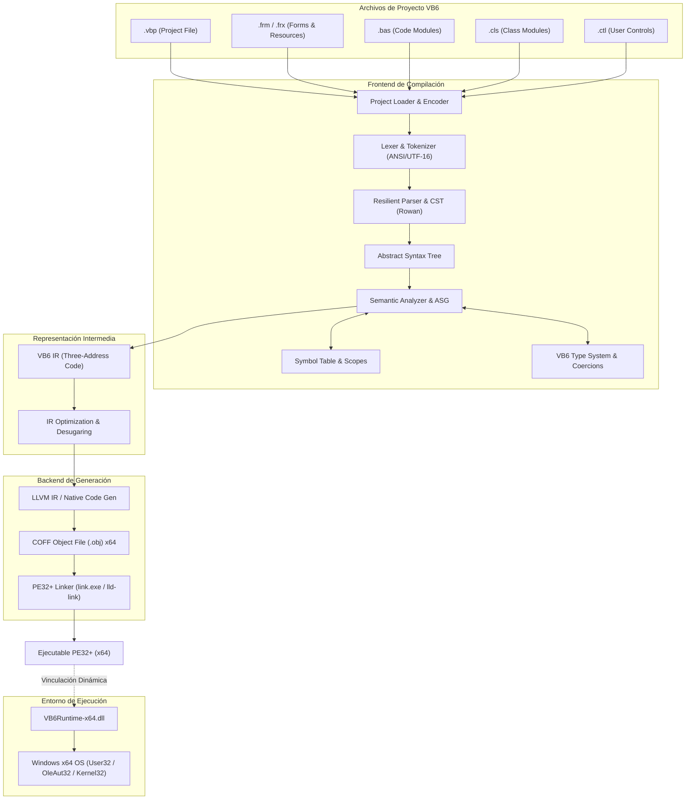

# Arquitectura del Sistema (ARCHITECTURE.md)
## VB6 Open Compiler x64

Versión 1.0 — Diseño del Sistema

---

## 1. Visión y Principios Arquitectónicos

El objetivo primordial de **VB6 Open Compiler x64** es permitir la compilación directa de proyectos clásicos de Microsoft Visual Basic 6.0 (`.vbp`) en ejecutables y bibliotecas nativas de Windows de 64 bits (`PE32+`), sin requerir migración manual de código a .NET o C++.

### Principios Rectores:
1. **Independencia Total (Clean-Room)**: Ninguna dependencia de código cerrado ni uso de bibliotecas propietarias.
2. **Desacoplamiento Estricto por Capas**:
   - Frontend (Lexer, Parser, CST, AST).
   - Analizador Semántico y Metamodelo de Símbolos (ASG).
   - Representación Intermedia propia (**VB6 IR**).
   - Generador de Código Nativo (**Backend x64 / LLVM / C Target**).
   - Runtime Nativo Independiente (**`VB6Runtime-x64.dll`**).
   - Sistema de Carga de Proyectos (**Project Loader**).
3. **Preservación del Comportamiento Observable**: La compatibilidad se mide por el comportamiento en tiempo de ejecución, no por la clonación de internals binarios de 32 bits.
4. **Diseño Multi-Arquitectura**: Base concebida primariamente para `x86_64`, pero preparada estructuralmente para `x86` y `aarch64` (ARM64).

---

## 2. Diagrama de Flujo del Compilador

---

## 3. Descripción de los Subsistemas

### 3.1. Project Loader (`project/`)
- Lee y analiza archivos de configuración `.vbp`.
- Extrae referencias COM (GUID, versión, ProgID), módulos fuente (`Module=...`), formularios (`Form=...`), clases (`Class=...`) y punto de entrada (`Startup="Sub Main"` o `Startup="Form1"`).
- Interpreta recursos binarios `.frx` (imágenes, iconos y propiedades serializadas de controles).
- Maneja codificaciones de caracteres históricas (Windows-1252 / ANSI a UTF-8/UTF-16).

### 3.2. Lexer y Parser (`compiler/lexer`, `compiler/parser`, `compiler/ast`)
- Implementa una gramática completa para VB6 basada en árboles de sintaxis concretos (CST) utilizando el enfoque de **Rowan** (sintaxis concreta sin pérdida de trivia).
- Maneja peculiaridades sintácticas históricas:
  - Sensibilidad al contexto en saltos de línea (delimitadores de instrucción vs. continuación de línea con `_`).
  - Separadores de instrucción en una misma línea (`:`).
  - Regla de llamadas de procedimiento: `Call MiSub(arg)` vs `MiSub arg` vs `X = MiFunc(arg)`.
  - Sufijos de tipo de variables (`%` para Integer, `&` para Long, `$` para String, `!` para Single, `#` para Double, `@` para Currency).

### 3.3. Analizador Semántico y Metamodelo (ASG) (`compiler/semantic`, `compiler/symbols`, `compiler/types`)
- Construcción del grafo semántico abstracto (ASG) inspirado en el metamodelo de ProLeap.
- Ámbitos léxicos jerárquicos: Global del proyecto, módulo, clase, procedimiento, bloques (`For`, `Do`, `Select`).
- Reglas de enlace y sobrecarga de propiedades (`Property Get`, `Property Let`, `Property Set`).
- Coerción implícita de tipos conforme al estándar OLE Automation.

### 3.4. Representación Intermedia (**VB6 IR**) (`compiler/ir`)
La representación intermedia propia es **obligatoria** para evitar el acoplamiento prematuro a LLVM y permitir optimizaciones específicas de Basic:
- Instrucciones atómicas tipadas:
  - **Memoria**: `LOAD`, `STORE`, `ALLOC`, `FREE`.
  - **Aritmética y Bits**: `ADD`, `SUB`, `MUL`, `DIV`, `IDIV`, `MOD`, `POW`, `AND`, `OR`, `XOR`, `NOT`.
  - **Control de Flujo**: `BRANCH`, `BRANCH_IF_TRUE`, `BRANCH_IF_FALSE`, `CALL`, `RETURN`.
  - **Tipos Especializados**: `STRING_CONCAT`, `VARIANT_CONVERT`, `ARRAY_ACCESS`, `ARRAY_REDIM`.
  - **Objetos y Propiedades**: `OBJECT_NEW`, `PROPERTY_GET`, `PROPERTY_LET`, `PROPERTY_SET`, `INVOKE_METHOD`.
  - **Manejo de Errores**: `PUSH_EXCEPTION_HANDLER`, `POP_EXCEPTION_HANDLER`, `RAISE_ERROR`, `RESUME`.

### 3.5. Backend y Enlazador (`backend/`, `linker/`)
- Generación de código nativo para la arquitectura `x86_64` (AMD64 / Intel 64).
- Convención de llamadas de Windows x64: primeros cuatro argumentos enteros/punteros en `RCX`, `RDX`, `R8`, `R9`, argumentos de coma flotante en `XMM0-XMM3`, zona de sombra de 32 bytes (*shadow space*).
- Formato de salida: Cabeceras `IMAGE_FILE_HEADER` y `IMAGE_OPTIONAL_HEADER64` con `Magic = 0x020B` (`PE32+`).
- Generación de símbolos de depuración en formato CodeView / PDB.

### 3.6. Runtime Nativo (`runtime/`)
El runtime `VB6Runtime-x64.dll` proporciona todas las funciones de soporte del lenguaje:
- **`core/`**: Inicialización del proceso, registro de salida, ciclo de vida.
- **`strings/`**: Manejo de cadenas BSTR UTF-16 (`Left$`, `Mid$`, `Right$`, `InStr`, `Trim$`, `Replace`, `Split`).
- **`variants/`**: Estructura `VARIANT` de 24 bytes para x64, reglas de conversión y coerciones numéricas.
- **`arrays/`**: Envoltorio de `SAFEARRAY` con límites dinámicos, `LBound`, `UBound`, `ReDim Preserve`.
- **`errors/`**: Objeto global `Err`, sincronización de `Err.Number`, `Err.Description`, soporte para `Resume`.
- **`forms/` y `controls/`**: Implementación de controles de interfaz gráfica nativos Win32 (ventanas, botones, etiquetas, cajas de texto) sin dependencias externas.
- **`events/`**: Enrutamiento de mensajes `WM_*` de Windows a los procedimientos de evento de VB6 (`_Click`, `_Change`, etc.).

---

## 4. Estrategia de Compatibilidad 32-bit / 64-bit

Un proceso compilado a x64 no puede cargar DLLs o controles OCX de 32 bits en su mismo espacio de direcciones virtual.

Para resolver este desafío sin romper proyectos existentes, la arquitectura contempla dos fases:
1. **Fase Nativa x64**: Todo el código VB6 y los componentes COM/DLL que dispongan de versiones de 64 bits se ejecutan de forma nativa a máxima velocidad.
2. **Fase de Puente IPC (Out-of-Process Helper)**: Para controles ActiveX/OCX heredados de 32 bits de los que solo exista binario x86, se dispondrá de un proceso anfitrión de 32 bits que cargará el OCX y se comunicará con el proceso principal x64 a través de memoria compartida / OLE DCOM / IPC de alto rendimiento.
